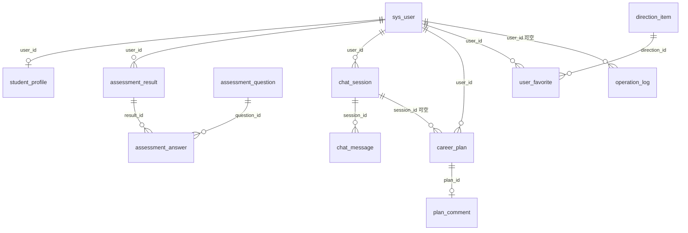

# CareerPilot 数据库设计说明

| 项 | 内容 |
| --- | --- |
| 项目 | 基于 AI 智能体的大学生职业生涯规划系统（SE2313-01） |
| 文档编号 | DBD-SE2313-V1.0-2026 |
| 版本 | V1.0 |
| 日期 | 2026-11-12 |
| 编制 | 高研 |
| 依据 | `文档/01-需求定义/需求定义书-开发周期节奏.md`（V1.2）第 8 章；`任务清单.md` 第 9 章；RTM No.1～111；测试成绩书用例 19、21、35、50、52 |
| 数据库 | SQLite 3 单文件 `career.db`，通过 Spring Data JPA 访问 |
| 交付物 | 本文、`career_schema.sql`（建表）、`career_seed.sql`（种子）、`career_check.sql`（验收查询） |
| 状态 | 设计完成；本机 SQLite 3 建库、约束和 17 条验收查询验证通过，待第 4 周接入 Spring Boot |

## 1. 设计目标与范围

按需求基线和任务清单，本期只有 14 张表，覆盖六个模块：用户与档案、测评、对话、方案、方向、公告参数日志。

设计的硬约束：

1. **只装 SQLite**，不安装独立数据库；删除 `career.db` 后重启能自动建表并写入种子（用例 52）。
2. **类型只按 SQLite**：主键 `INTEGER` 自增，外键 `INTEGER`，其余文本和时间 `TEXT`。
3. 演示规模约 50 个学生、1 个老师、1 个管理员；每人最多 3 次测评、5 份方案（由应用控制，见第 7 节）。
4. 不做归档库、不做分区、不按学院隔离。
5. 密钥只放环境变量，`sys_config` 和任何表都不存密钥。

不在本设计内的内容：简历、模拟面试、爬虫、薪资、向量库、学习任务、附件上传、导出报表。这些在需求第 2.2 节已排除。

## 2. 总体约定

| 项 | 约定 |
| --- | --- |
| 文件 | `career.db`，开发时放在后端工作目录，已被 `.gitignore` 忽略，不提交真实对话 |
| 字符集 | UTF-8 |
| 时间 | `TEXT`，格式 `YYYY-MM-DD HH:MM:SS`，按运行机器本地时间写入；由应用赋值，不依赖数据库时区 |
| 主键 | `INTEGER PRIMARY KEY AUTOINCREMENT`，插入后不回填业务编号 |
| 外键 | `INTEGER REFERENCES …`；外键字段都建索引；外键强制依赖连接级 PRAGMA |
| 布尔 | `INTEGER`，0 假 1 真 |
| 枚举 | `TEXT` + `CHECK (… IN (…))`，中文值按需求原样存（如「就业」「登录」） |
| 逻辑删除 | 会话用 `deleted_flag`，题目用 `enabled`，方向用 `status`，公告用 `offline`；不物理删除 |
| 命名 | 表名、字段名小写下划线；索引 `idx_表名_用途` |
| 连接 PRAGMA | 每个连接必须执行 `PRAGMA foreign_keys = ON`；建议 `journal_mode = WAL`、`busy_timeout = 5000` |

外键不会因为建表脚本里的 `PRAGMA` 就一直生效，它是**连接级**开关。Spring Boot 里建议：

```yaml
spring:
  datasource:
    url: jdbc:sqlite:career.db
    hikari:
      connection-init-sql: PRAGMA foreign_keys = ON
```

## 3. 表关系

```text
sys_user 1 ──< student_profile      （一个学生一条档案，user_id 唯一）
sys_user 1 ──< assessment_result 1 ──< assessment_answer >── 1 assessment_question
sys_user 1 ──< chat_session 1 ──< chat_message
sys_user 1 ──< career_plan >── 0..1 chat_session（可空）
career_plan 1 ──< plan_comment（一个方案最多一条）
sys_user 1 ──< user_favorite >── 1 direction_item
sys_user 1 ──< operation_log（user_id 可空）
announcement、sys_config 独立，不挂用户
```



## 4. 表结构

### 4.1 `sys_user` 用户账号

| 字段 | 类型 | 约束 | 说明 |
| --- | --- | --- | --- |
| id | INTEGER | PK 自增 | 用户编号 |
| student_no | TEXT | NOT NULL UNIQUE，11 位数字 | 学号 / 工号，学生注册填写，老师和管理员由初始化写入 |
| password_hash | TEXT | NOT NULL，60 位且以 `$2` 开头 | 只存 bcrypt，禁止明文 |
| role | TEXT | NOT NULL，`student / teacher / admin` | 角色，权限以 Spring Boot 校验为准 |
| real_name | TEXT | NOT NULL，1～20 字 | 姓名，档案四项必填之一取这里 |
| status | INTEGER | NOT NULL 默认 1，0/1 | 0 停用。停用学生仍计入注册数 |
| fail_count | INTEGER | NOT NULL 默认 0，0～5 | 连续登录失败次数，成功登录清零 |
| locked_until | TEXT | 可空 | 锁定截止时间；第 5 次失败写入当前时间 + 15 分钟 |
| created_at | TEXT | NOT NULL | 创建时间 |
| updated_at | TEXT | NOT NULL | 更新时间 |

索引：`idx_user_role(role)`；`student_no` 由 UNIQUE 约束自带索引。

约束说明：学号用 `GLOB '[0-9]…[0-9]'` 强制 11 位数字；密码哈希长度和前缀保证不会存明文。

### 4.2 `student_profile` 学业档案

| 字段 | 类型 | 约束 | 说明 |
| --- | --- | --- | --- |
| id | INTEGER | PK 自增 | 主键 |
| user_id | INTEGER | NOT NULL UNIQUE，FK `sys_user(id)` CASCADE | 一个学生一条 |
| grade | TEXT | 可空，≤10 字 | 年级，必填项之一 |
| major | TEXT | 可空，≤40 字 | 专业，必填项之一 |
| rank_band | TEXT | NOT NULL 默认「未填」，四选一 | 前 30% / 中游 / 后 30% / 未填；不参与完成判断，不收各科分数 |
| preference | TEXT | 可空，五选一 | 就业 / 考研 / 考公 / 创业 / 还没想好 |
| gender | TEXT | 可空，≤4 字 | 选填 |
| class_name | TEXT | 可空，≤20 字 | 选填 |
| phone | TEXT | 可空，≤20 字 | 选填；展示时应用隐藏中间四位，库里仍是 11 位原值 |
| email | TEXT | 可空，≤60 字 | 选填 |
| city | TEXT | 可空，≤20 字 | 意向城市，选填 |
| intro | TEXT | 可空，≤300 字 | 自我说明 |
| complete_flag | INTEGER | NOT NULL 默认 0，0/1 | 姓名、年级、专业、去向偏好四项齐全时由应用置 1 |
| created_at | TEXT | NOT NULL | 创建时间 |
| updated_at | TEXT | NOT NULL | 更新时间 |

说明：姓名不重复存，取 `sys_user.real_name`；四项必填里姓名改的是 `sys_user`，其余三项在本表。

### 4.3 `assessment_question` 测评题目

| 字段 | 类型 | 约束 | 说明 |
| --- | --- | --- | --- |
| id | INTEGER | PK 自增 | 题目编号 |
| stem | TEXT | NOT NULL，1～200 字 | 题干 |
| option_a | TEXT | NOT NULL，1～100 字 | 选项 A |
| option_b | TEXT | NOT NULL，1～100 字 | 选项 B |
| type_a | TEXT | NOT NULL，RIASEC | A 的类型 |
| type_b | TEXT | NOT NULL，RIASEC | B 的类型，且必须与 A 不同（表级 CHECK） |
| sort_no | INTEGER | NOT NULL 默认 0 | 展示顺序，一次展示全部启用题 |
| enabled | INTEGER | NOT NULL 默认 1，0/1 | 停用后学生作答页不再出现 |
| created_at | TEXT | NOT NULL | 创建时间 |
| updated_at | TEXT | NOT NULL | 更新时间 |

索引：`idx_question_enabled(enabled, sort_no)`。

「已有人作答的题只能停用，不能改选项」由应用校验：保存前查 `assessment_answer` 是否存在该题记录。数据库层面用 `assessment_answer.question_id` 的 `ON DELETE RESTRICT` 保证不会误删被作答的题。

### 4.4 `assessment_result` 一次测评结果

| 字段 | 类型 | 约束 | 说明 |
| --- | --- | --- | --- |
| id | INTEGER | PK 自增 | 结果编号 |
| user_id | INTEGER | NOT NULL FK `sys_user(id)` CASCADE | 哪个学生 |
| score_r … score_c | INTEGER | NOT NULL 默认 0，0～24 | 六型得分，列名 score_r / score_i / score_a / score_s / score_e / score_c |
| top1 | TEXT | NOT NULL，RIASEC | 第一型 |
| top2 | TEXT | NOT NULL，RIASEC，且不等于 top1 | 第二型 |
| tie_flag | INTEGER | NOT NULL 默认 0，0/1 | 截取第二型时是否发生并列，页面据此注明 |
| created_at | TEXT | NOT NULL | 提交时间 |

索引：`idx_result_user(user_id, created_at DESC)`。

每人只留最近 3 次由应用实现（见 7.1），第 4 次提交时删除最早一条，级联删除作答明细。

### 4.5 `assessment_answer` 作答明细

| 字段 | 类型 | 约束 | 说明 |
| --- | --- | --- | --- |
| id | INTEGER | PK 自增 | 主键 |
| result_id | INTEGER | NOT NULL FK `assessment_result(id)` CASCADE | 属于哪次结果 |
| question_id | INTEGER | NOT NULL FK `assessment_question(id)` RESTRICT | 哪道题 |
| chosen_option | TEXT | NOT NULL，`A / B` | 选了哪个选项；选项类型由题目带出，不重复存 |

约束：`UNIQUE(result_id, question_id)` 防止同一题在同一份答卷里出现两次；索引 `idx_answer_question(question_id)` 用于「该题是否被作答」。

老师接口不返回本表，从表和查询两边都不提供。

### 4.6 `chat_session` 对话会话

| 字段 | 类型 | 约束 | 说明 |
| --- | --- | --- | --- |
| id | INTEGER | PK 自增 | 会话编号 |
| user_id | INTEGER | NOT NULL FK `sys_user(id)` CASCADE | 只属于一个学生 |
| title | TEXT | NOT NULL 默认「新的规划对话」，1～20 字 | 标题可空，空时应用写默认值；超过 20 字拒绝 |
| deleted_flag | INTEGER | NOT NULL 默认 0，0/1 | 删除只改标记，列表和统计不再计入 |
| created_at | TEXT | NOT NULL | 创建时间 |
| updated_at | TEXT | NOT NULL | 更新时间 |

索引：`idx_session_user(user_id, deleted_flag, id)`。

### 4.7 `chat_message` 会话消息

| 字段 | 类型 | 约束 | 说明 |
| --- | --- | --- | --- |
| id | INTEGER | PK 自增 | 消息编号 |
| session_id | INTEGER | NOT NULL FK `chat_session(id)` CASCADE | 所属会话 |
| sender | TEXT | NOT NULL，`user / assistant` | 发送方 |
| content | TEXT | NOT NULL，1～500 字 | 正文；500 字上限与页面输入限制一致 |
| mock_flag | INTEGER | NOT NULL 默认 0，0/1 | 1 表示模拟回复，页面据此显示黄条原文 |
| created_at | TEXT | NOT NULL | 发送时间 |

索引：`idx_message_session(session_id, id)`。

**老师接口和统计接口的 SQL 不得 SELECT 本表 `content`**，消息查询只挂在学生本人的接口上（用例 13、RTM No.80、83、105）。失败或超时的本轮不写库。

### 4.8 `career_plan` 规划方案

| 字段 | 类型 | 约束 | 说明 |
| --- | --- | --- | --- |
| id | INTEGER | PK 自增 | 方案编号 |
| user_id | INTEGER | NOT NULL FK `sys_user(id)` CASCADE | 属于哪个学生 |
| session_id | INTEGER | 可空 FK `chat_session(id)` SET NULL | 从哪个会话生成；会话被清理时置空，方案仍保留 |
| content | TEXT | NOT NULL，1～5000 字 | 方案正文，保存前应用检查四个标题和书名号 |
| source | TEXT | NOT NULL，`model / mock` | 来源，详情页要能区分 |
| created_at | TEXT | NOT NULL | 生成时间 |

索引：`idx_plan_user(user_id, created_at DESC)`、`idx_plan_session(session_id)`。

每人最多 5 份由应用校验；正文里的方向名称是中文书名号文本，不建外键，保存时到 `direction_item` 校验。

### 4.9 `direction_item` 方向库

| 字段 | 类型 | 约束 | 说明 |
| --- | --- | --- | --- |
| id | INTEGER | PK 自增 | 方向编号 |
| name | TEXT | NOT NULL UNIQUE，1～20 字 | 方向名称，全库唯一 |
| category | TEXT | NOT NULL，`就业 / 考研 / 考公 / 创业` | 类别只有四个，没有「还没想好」 |
| holland_tags | TEXT | NOT NULL，`R/I/A/S/E/C` 单字母或 `X,Y` | 类型标签，如 `I,C` |
| summary | TEXT | NOT NULL，1～200 字 | 简介，不写薪资 |
| action_text | TEXT | NOT NULL，恰好一个换行 | 两条在校可做的事，用换行分隔 |
| status | INTEGER | NOT NULL 默认 1，0/1 | 1 上架 0 下架；下架后不参与新推荐，旧方案仍显示原名 |
| created_at | TEXT | NOT NULL | 创建时间 |
| updated_at | TEXT | NOT NULL | 更新时间 |

索引：`idx_direction_status(status, category)`。

**本表没有薪资字段**，简介里也不写薪资。已被收藏或被方案引用的方向不物理删除：收藏由外键 RESTRICT 挡住，方案引用由应用检查正文里的书名号。

### 4.10 `user_favorite` 方向收藏

| 字段 | 类型 | 约束 | 说明 |
| --- | --- | --- | --- |
| id | INTEGER | PK 自增 | 主键 |
| user_id | INTEGER | NOT NULL FK `sys_user(id)` CASCADE | 学生 |
| direction_id | INTEGER | NOT NULL FK `direction_item(id)` RESTRICT | 方向 |
| created_at | TEXT | NOT NULL | 收藏时间 |

约束：`UNIQUE(user_id, direction_id)`，再点一次取消收藏即删除本行；索引 `idx_favorite_direction(direction_id)`。下架方向不能新收藏由应用判断，已收藏后下架的记录保留。

### 4.11 `plan_comment` 老师评语

| 字段 | 类型 | 约束 | 说明 |
| --- | --- | --- | --- |
| id | INTEGER | PK 自增 | 主键 |
| plan_id | INTEGER | NOT NULL UNIQUE FK `career_plan(id)` CASCADE | 一个方案最多一条 |
| teacher_id | INTEGER | NOT NULL FK `sys_user(id)` RESTRICT | 写评语的老师 |
| content | TEXT | NOT NULL，1～200 字 | 评语正文 |
| created_at | TEXT | NOT NULL | 最近一次保存时间，覆盖时更新 |

约束：`plan_id` 唯一即「只留最新一条」；覆盖前确认由应用弹框。删除方案时级联删除评语（用例 40）。索引 `idx_comment_teacher(teacher_id)`。

### 4.12 `announcement` 公告

| 字段 | 类型 | 约束 | 说明 |
| --- | --- | --- | --- |
| id | INTEGER | PK 自增 | 公告编号 |
| title | TEXT | NOT NULL，1～40 字 | 标题 |
| content | TEXT | NOT NULL，1～500 字 | 正文 |
| pinned | INTEGER | NOT NULL 默认 0，0/1 | 置顶排第一 |
| offline | INTEGER | NOT NULL 默认 0，0/1 | 下线后学生和老师首页都不显示，不物理删除 |
| created_at | TEXT | NOT NULL | 发布时间 |
| updated_at | TEXT | NOT NULL | 更新时间 |

索引：`idx_announcement_list(offline, pinned DESC, id DESC)`。种子至少一条写明本系统是实训演示。

### 4.13 `sys_config` 模型参数

| 字段 | 类型 | 约束 | 说明 |
| --- | --- | --- | --- |
| id | INTEGER | PK，固定为 1 | 单行表，`CHECK (id = 1)` |
| api_url | TEXT | NOT NULL | 模型接口地址 |
| model_name | TEXT | NOT NULL | 模型名 |
| timeout_seconds | INTEGER | NOT NULL 默认 30，5～60 | 超时秒数 |
| assistant_on | INTEGER | NOT NULL 默认 1，0/1 | 助手开关，关闭后学生不能发消息、不能生成方案 |
| mock_on | INTEGER | NOT NULL 默认 0，0/1 | 模拟回复开关，默认关闭 |
| disclaimer | TEXT | NOT NULL | 免责声明，默认 T-01 原文 |
| updated_at | TEXT | NOT NULL | 更新时间 |

**本表没有密钥字段**，密钥只来自环境变量；接口和页面都不返回密钥（用例 50）。

### 4.14 `operation_log` 关键操作日志

| 字段 | 类型 | 约束 | 说明 |
| --- | --- | --- | --- |
| id | INTEGER | PK 自增 | 日志编号 |
| user_id | INTEGER | 可空 FK `sys_user(id)` SET NULL | 操作者，系统动作可为空 |
| action | TEXT | NOT NULL，7 种取值 | 登录 / 重置密码 / 生成方案 / 删除方案 / 改题目 / 改方向 / 改参数 |
| target_type | TEXT | 可空 | 对象类型，如 `career_plan`、`sys_user` |
| target_id | TEXT | 可空 | 对象编号 |
| client_ip | TEXT | 可空 | 客户端 IP |
| created_at | TEXT | NOT NULL | 操作时间 |

索引：`idx_log_user(user_id, created_at DESC)`、`idx_log_action(action, created_at DESC)`。

**本表没有聊天正文字段**，只增不改（应用不提供修改和删除接口），学生和老师看不到日志入口。

## 5. 索引汇总

| 索引 | 表 | 字段 | 用途 |
| --- | --- | --- | --- |
| idx_user_role | sys_user | role | 按角色查用户、统计 |
| idx_question_enabled | assessment_question | enabled, sort_no | 取启用题、判断是否少于 18 道 |
| idx_result_user | assessment_result | user_id, created_at DESC | 取最近一次、保留最近 3 次 |
| idx_answer_question | assessment_answer | question_id | 判断题目是否已被作答 |
| idx_session_user | chat_session | user_id, deleted_flag, id | 学生会话列表 |
| idx_message_session | chat_message | session_id, id | 会话消息按顺序翻页 |
| idx_plan_user | career_plan | user_id, created_at DESC | 我的方案列表、份数上限 |
| idx_plan_session | career_plan | session_id | 外键索引 |
| idx_direction_status | direction_item | status, category | 只取上架方向、按类别推荐 |
| idx_favorite_direction | user_favorite | direction_id | 外键索引、判断是否被收藏 |
| idx_comment_teacher | plan_comment | teacher_id | 外键索引 |
| idx_announcement_list | announcement | offline, pinned DESC, id DESC | 首页公告排序 |
| idx_log_user | operation_log | user_id, created_at DESC | 按学生筛日志 |
| idx_log_action | operation_log | action, created_at DESC | 按动作筛日志 |

另有 6 个 UNIQUE 约束自带索引：`sys_user.student_no`、`student_profile.user_id`、`direction_item.name`、`assessment_answer(result_id, question_id)`、`user_favorite(user_id, direction_id)`、`plan_comment.plan_id`。

## 6. 数据库管什么、应用管什么

数据库负责结构正确和引用完整，业务规则仍放在 Spring Boot（需求第 3 章：权限以 Spring Boot 的检查为准；需求第 9 章：失败返回中文提示）。

| 规则 | 数据库 | 应用 |
| --- | --- | --- |
| 学号 11 位、密码哈希格式 | ✅ CHECK | 注册时校验唯一、密码规则 |
| 角色只能是三种 | ✅ CHECK | 按角色拒绝越权，返回 403 并记日志 |
| 去向偏好、成绩档次枚举 | ✅ CHECK | 下拉选项、中文错误提示 |
| 档案 300 字、评语 200 字、公告 40/500 字 | ✅ CHECK | 字数提示、超长时保留输入 |
| 题目两选项类型不同、属于 RIASEC | ✅ CHECK | 维护页校验并给中文原因 |
| 已作答题目不能改选项 | ❌ | 保存前查作答记录，失败给中文提示 |
| 启用题少于 18 道不能作答 | ❌ | 查询启用数，学生端整页「题目维护中」 |
| 每人只留 3 次测评 | ❌ | 提交第 4 次时删除最早一条（级联删明细） |
| 每人最多 5 份方案 | ❌ | 保存前计数，已满提示先删除 |
| 四个标题、书名号必须来自方向库 | ❌ | 保存前检查正文，不合格不写库 |
| 老师不能看聊天正文 | ❌（无视图、无跨表查询） | 消息接口只开给学生本人 |
| 参数超时 5～60 秒、无密钥 | ✅ CHECK | 管理页校验并返回中文提示 |
| 日志只增不改、按学生筛 | 结构保证 | 只提供写入和查询，不提供修改删除 |

## 7. 生命周期与删除规则

### 7.1 测评只留最近 3 次

应用在插入新结果后执行：

```sql
DELETE FROM assessment_result
WHERE user_id = :userId
  AND id NOT IN (
    SELECT id FROM assessment_result
    WHERE user_id = :userId
    ORDER BY created_at DESC, id DESC
    LIMIT 3
  );
```

`assessment_answer.result_id` 是 `ON DELETE CASCADE`，明细随结果一起删除（用例 21）。

### 7.2 方案与评语

- 删除方案：`DELETE FROM career_plan WHERE id = ? AND user_id = ?`，评语级联删除（用例 40）。
- 删除方案写一条「删除方案」日志，日志里没有对话原文。
- 学生不能改正文：应用不提供更新接口，正文也没有 `updated_at`。
- 老师评语：同一 `plan_id` 只有一行，覆盖用 `UPDATE`，覆盖前应用弹确认框。

### 7.3 会话

- 学生删除会话：`UPDATE chat_session SET deleted_flag = 1, updated_at = ?`。
- 列表和统计查询都带 `deleted_flag = 0`，硬删除只留给测试清理，硬删时消息级联删除。

### 7.4 题目、方向、公告

- 题目：已作答只能 `enabled = 0`；启用数少于 18 道时学生端整页「题目维护中」。
- 方向：只 `status = 0` 下架，不物理删除；被收藏时外键 RESTRICT 会拦住删除。
- 公告：只 `offline = 1` 下线，不下线删除。

## 8. 种子数据

`career_seed.sql` 使用固定主键和 `INSERT OR IGNORE`，重复执行不会产生重复数据；删库后重启即可重建。

### 8.1 账号

| 角色 | 学号 | 姓名 | 密码（写在 README，不在网页上） | 库中存储 |
| --- | --- | --- | --- | --- |
| 管理员 | 20230000001 | 系统管理员 | Admin123456 | bcrypt 60 位哈希 |
| 就业指导老师 | 20230009001 | 王建国 | Teacher123456 | bcrypt 60 位哈希 |
| 学生（演示） | 20230001001 | 张小明 | Student123456 | bcrypt 60 位哈希，档案四项齐全，`complete_flag = 1` |

bcrypt 代价因子 10，`CHECK (length(password_hash) = 60 AND password_hash GLOB '$2*')` 保证库里不会是明文。

### 8.2 24 道测评题

| 题号 | 选项 A 类型 | 选项 B 类型 | 题号 | 选项 A 类型 | 选项 B 类型 |
| --- | --- | --- | --- | --- | --- |
| 1～4 | R | I | 17～20 | R | S |
| 5～8 | A | S | 21～24 | A | E |
| 9～12 | E | C |  |  |  |
| 13～16 | I | C |  |  |  |

六种类型作为选项各出现 8 次，两选项类型每题都不同；题目内容为小组自编的职业兴趣题，不调用模型。

### 8.3 8 个方向

| 名称 | 类别 | 标签 | 名称 | 类别 | 标签 |
| --- | --- | --- | --- | --- | --- |
| 软件开发 | 就业 | I,R | 考公计算机岗 | 考公 | C |
| 软件测试 | 就业 | C,I | 考公综合岗 | 考公 | S |
| 产品助理 | 就业 | E,S | 校园技术创业 | 创业 | E,I |
| 计算机升学 | 考研 | I | 先补基础 | 就业 | R,C |

四类齐全（就业 4、考研 1、考公 2、创业 1）；每条含 200 字以内简介和两条在校可做的事，没有薪资字段。

### 8.4 公告与参数

- 公告 1 条：标题「欢迎使用 CareerPilot（教学演示）」，置顶、未下线，正文写明本系统是实训演示、不保证录取或就业。
- 参数 1 行：超时 30 秒、助手开、模拟回复关、免责声明为 T-01 原文，无密钥字段。

### 8.5 验收查询

`career_check.sql` 直接给出 17 条核对查询和期望值，覆盖用例 52：14 张表、14 个索引、24 题、六型各 8 次、8 个方向四类齐全、教学演示公告、参数默认值、3 个 bcrypt 账号、外键与完整性检查。

## 9. 与需求、RTM、用例的对应

| 表 | 需求 | RTM No. | 主要用例 |
| --- | --- | --- | --- |
| sys_user | FR-M1-01、FR-M1-02 | 1～11、18、106、109 | 1～5、15 |
| student_profile | FR-M1-03、FR-M2-04 | 15、19～30、79 | 6～11 |
| assessment_question | FR-M2-01 | 31、32、34、84～87、91 | 17～19、52 |
| assessment_result | FR-M2-02、FR-M2-03、FR-M2-04 | 37～41、79 | 21～25 |
| assessment_answer | FR-M2-02 | 33～36 | 19～21 |
| chat_session、chat_message | FR-M3-01～04 | 42～53、80、83、105 | 26～33 |
| career_plan | FR-M4-01、FR-M4-02 | 54～68、110 | 34～40、54 |
| plan_comment | FR-M4-04 | 60、76～83 | 13、42 |
| direction_item | FR-M5-01、FR-M5-02 | 69～75、88～91 | 43～47、52 |
| user_favorite | FR-M5-03 | 74、75 | 48 |
| announcement | FR-M6-01 | 14、93～95 | 49 |
| sys_config | FR-M6-02 | 52、96～99 | 33、50 |
| operation_log | FR-M1-04 | 67、104～106 | 16、40 |
| 统计四个数字 | FR-M6-03 | 92、100～103 | 51 |

统计四个数字不建表，直接查：

```sql
SELECT COUNT(*) FROM sys_user WHERE role = 'student';                     -- 注册学生数（含停用）
SELECT COUNT(*) FROM student_profile WHERE complete_flag = 1;             -- 档案完成数
SELECT COUNT(DISTINCT user_id) FROM assessment_result;                    -- 测评人数
SELECT COUNT(*) FROM career_plan;                                        -- 方案份数
```

## 10. 使用与验证

### 10.1 用 sqlite3 建库

```bash
sqlite3 career.db < 文档/04-数据库设计/career_schema.sql
sqlite3 career.db < 文档/04-数据库设计/career_seed.sql
sqlite3 career.db < 文档/04-数据库设计/career_check.sql
```

`career_check.sql` 每条都带期望值，结果与期望一致即可作为用例 52 的证据。

同目录下有一份本地生成的 `career.db`（2026-11-12，只含种子数据，没有任何真实对话和方案），可直接用 sqlite3 或 Navicat 打开核对。该文件被 `.gitignore` 忽略，不会随仓库提交；换机器时按上面的命令重新生成即可。

### 10.2 Spring Boot 集成

第 4 周建后端时，把两个脚本放到 `backend/src/main/resources/db/`：

```yaml
spring:
  datasource:
    url: jdbc:sqlite:career.db
    hikari:
      connection-init-sql: PRAGMA foreign_keys = ON
  sql:
    init:
      mode: always
      schema-locations: classpath:db/career_schema.sql
      data-locations: classpath:db/career_seed.sql
  jpa:
    hibernate:
      ddl-auto: none
    open-in-view: false
```

脚本是可重复执行的，`mode: always` 不会重复建表或重复插种子。表由脚本建，不要让 Hibernate 自动建表。

### 10.3 实体映射约定

| SQLite | Java | 说明 |
| --- | --- | --- |
| INTEGER PK | Long | `@GeneratedValue(strategy = IDENTITY)` |
| INTEGER 0/1 | Boolean / Integer | 布尔列用 `Boolean`，方言存 0/1；不确定时用 `Integer` |
| TEXT 枚举 | String 或枚举 | 用 `@Enumerated(EnumType.STRING)`；中文动作名建议直接用 String |
| TEXT 时间 | String 或 LocalDateTime | SQLite 方言对时间类型有差异，建议 `String` 或写 `AttributeConverter<LocalDateTime, String>`，固定 `yyyy-MM-dd HH:mm:ss` |
| TEXT 长文本 | String | 方案正文、聊天内容、简介 |

### 10.4 删库重建

删除后端工作目录下的 `career.db`（如存在 `career.db-wal`、`career.db-shm` 一并删除），重启应用，脚本重新建表并写入种子；管理员用 20230000001 / Admin123456 登录，题目 24 道、方向 8 条、公告 1 条。这正是用例 52 的验收步骤。

## 11. 设计取舍

1. **答案不存选项类型**：`assessment_answer` 只存选了 A 还是 B，类型从 `assessment_question` 带出。因为已作答的题禁止改选项，join 出来的类型与提交时一致，少一列少一处不一致。
2. **姓名放在 `sys_user`**：需求第 8 章 `student_profile` 字段里没有姓名，四项必填中的姓名取账号表，避免两处存两个值。
3. **方向引用用名称文本**：方案正文里的《》名称不建外键，因为方案正文是整段文本；保存时由应用到方向库校验，方向下架后旧方案仍显示原名。
4. **`action_text` 用换行分隔两条**：保持与模版字段一致，不拆成两张表；CHECK 约束保证恰好两条。
5. **单行 `sys_config`**：参数是全局配置，`CHECK (id = 1)` 固定一行，避免多行时取哪一行的问题。
6. **时间用 TEXT 本地时间**：符合需求第 8 章的类型约定，演示时页面上显示的就是本机时间，不用做时区换算。
7. **触发器不放进建表脚本**：Spring 的初始化脚本按分号切分语句，触发器内部的 `BEGIN … END` 容易被拆错；「日志只增不改」「已作答不能改选项」这类规则放在应用层，靠只提供相应接口来保证。若以后要在库层兜底，可以单独用迁移工具执行触发器。
8. **每连接 PRAGMA**：SQLite 外键默认关闭，必须在连接池初始化时打开，否则级联和引用检查都不会生效。

## 12. 变更记录

| 版本 | 日期 | 内容 |
| --- | --- | --- |
| V1.0 | 2026-11-12 | 按需求基线 V1.2、任务清单第 9 章建立 14 张表、14 个索引和种子数据设计，附建表、种子、验收三个 SQL 脚本 |
